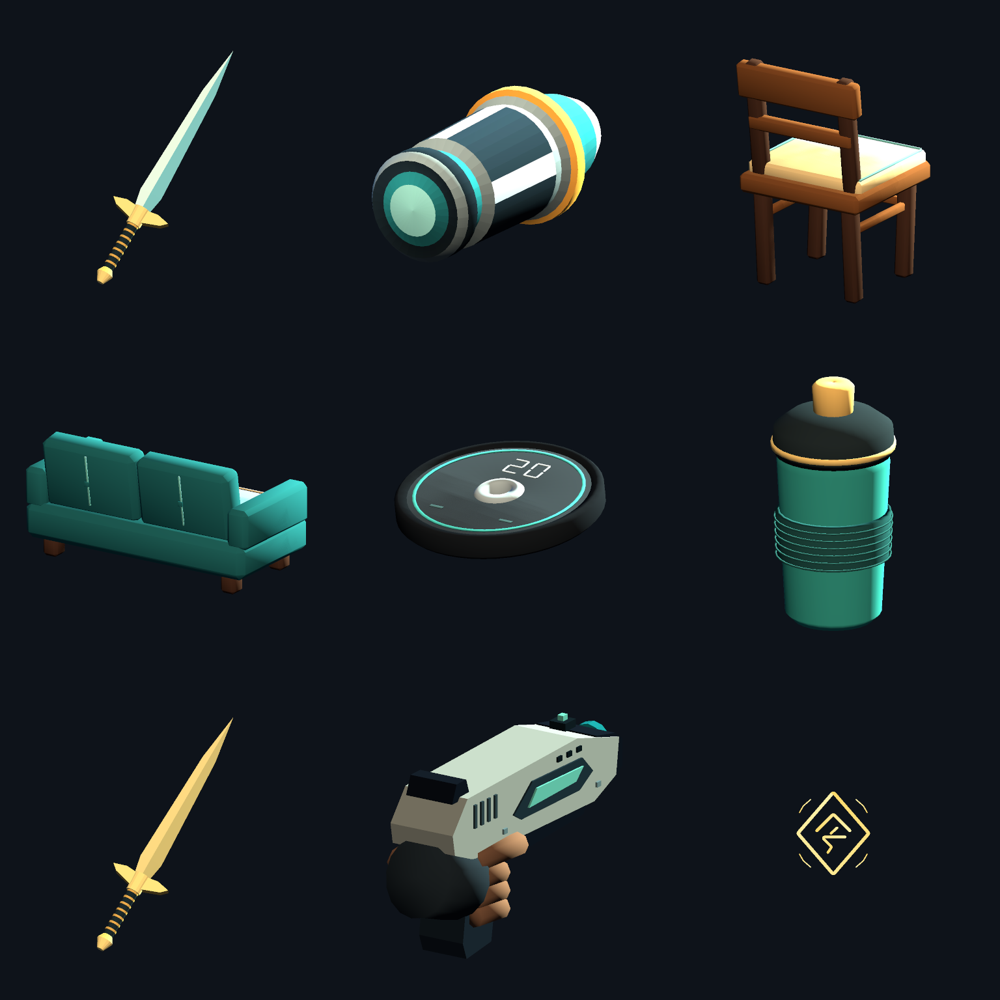
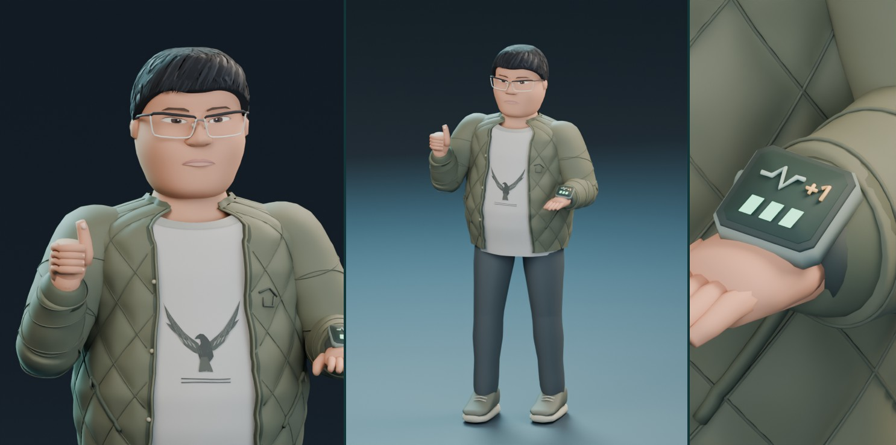
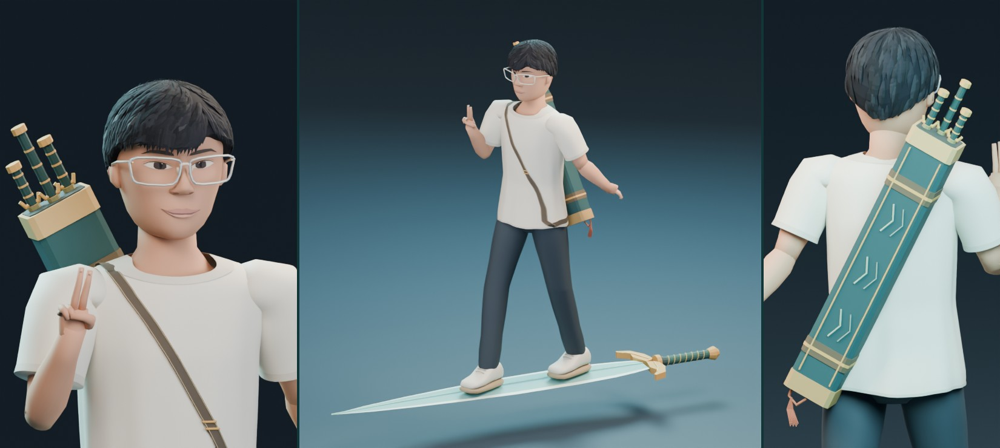
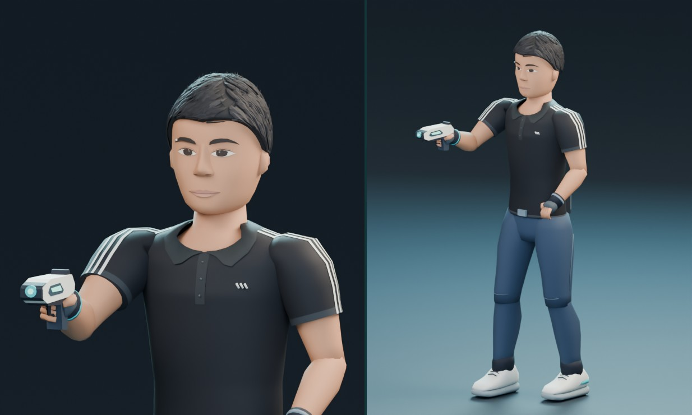
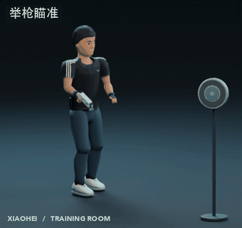
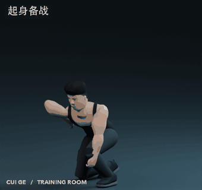

# 小黑大哥合集

0.5.24 崔哥组合拳范围继续加大：前两拳距离 10 米、判定半径 3.5 米，上勾拳距离 11 米、判定半径 4.2 米，拳影特效同步放大。伤害与攻速不变。联机时所有玩家都需更新到 0.5.24。

0.5.23 崔哥组合拳范围翻倍：前两拳距离从 3 米提高到 6 米、判定半径从 1.05 米提高到 2.1 米，上勾拳距离从 3.3 米提高到 6.6 米、判定半径从 1.25 米提高到 2.5 米，拳影特效同步放大。伤害与攻速不变。联机时所有玩家都需更新到 0.5.23。

0.5.22 地面移速调整为旧版的 2.7 倍：崔哥 21.6 米/秒、小黑 20.25 米/秒、杰哥和伟哥 18.9 米/秒。飞行速度基本不变，改为地面移速的 2.2 倍，初始约 48、45、42 米/秒。

0.5.21 拆分地面与飞行速度：地面移速从旧版的 5 倍降到 2 倍，崔哥 16 米/秒、小黑 15 米/秒、杰哥和伟哥 14 米/秒。X 飞行和杰哥御剑改为当前地面移速的 3 倍，初始分别为 48、45、42 米/秒，原版幸存者的 X 飞行同样是 3 倍。

0.5.20 修复高攻速联机吞子弹：房主对其他玩家普攻的限速校验原本只容忍极短的网络抖动，网络稍有卡顿就会丢弃客机已经打出的子弹。现在崔哥、小黑、杰哥和伟哥的普攻校验统一放宽，能容忍约 0.7 秒的网络积压，攻速、伤害和房主手感不变。联机时所有玩家都需更新到 0.5.20。

0.5.19 借用火影合集（NarutoCollection，作者 Zerneas）的招式特效：崔哥连拳出疾风传打击火花，上勾拳炸螺旋丸，重砸是尾兽玉配焦土坑，满蓄冲撞带九尾咆哮冲击；小黑开枪出佐助打击火花，追踪弹命中劈麒麟雷，巨型分身每发都是雷遁冲击；杰哥飞剑出水门打击火花，「剑来」回程每只怪挨一道飞雷神斩，万剑归宗金剑出六道火花，天剑落地炸六道金色爆发加螺旋手里剑；伟哥椅子冲击波、沙发螺旋丸、餐桌再不斩斩击、冰箱白的冰镜碎裂、落地灯千鸟、衣柜重砸，抛怪命中也有冲击。重击附带镜头震动，轻击按频率和同屏数量限流。特效素材不随本包分发：需同时安装 NarutoCollection，未安装时只保留原有特效，不影响游戏。伤害与机制不变。

0.5.18 将崔哥、小黑、杰哥和伟哥的初始攻速统一提高至原来的 10 倍，初始移速提高至原来的 5 倍：崔哥 40 米/秒、小黑 37.5 米/秒、杰哥和伟哥 35 米/秒。

0.5.17 修正小黑大招：现在只有一个留在施放位置的十五米巨型发光分身，身体、背轮、地面光阵和实际枪口属于同一对象，不再保留小分身加镜头法相的双重表现。分身持续 4 秒，自动索敌周围 60 米内可见敌人，目标死亡或被地形遮挡时自动转火。基础 18 发，每层高光增加 6 发，满层 36 发；每发 250% 伤害、冷却 10 秒。本人可自由移动和射击。

0.5.16 强化指定技能特效：小黑闪现／回位增加蓝紫裂隙、白色能量芯、两端扩散环与粒子；右键侧滑留下短促光轨。杰哥闪现增加加粗青白剑光、四道残剑与双端符环，持续约 0.58 秒。伟哥「全选」成功施放时出现蓝色指令光阵、升腾光柱、逐目标选中框和连接线，全选投掷物带更亮的蓝白尾迹。小黑大招保留原射击分身，额外召出约十五米高的蓝紫光能法相，配旋转背轮、地面法阵、升腾光束与脉冲；施法者在画面左侧看见完整投影，其他玩家看见世界中的巨像。伤害、冷却、弹道与持续时间不变，普通走路、跳跃和飞行不产生这些技能效果。

0.5.15 技能视觉整理：取消普通移动、跳跃和飞行自动产生的光环、拖尾；崔哥真实双拳常驻金光，并随泵感和出拳增强。杰哥飞剑重做钢刃、金属护手、剑脊符纹和双层渐细尾迹，回剑后九剑悬浮背后，数量随在外飞剑同步。万剑归宗的巨型法相改为施法者视野左侧的半透明投影，保留完整轮廓及瞄准空间；其他玩家仍看见世界中的大法相。拳击、重砸、追踪弹、分身、治疗、传送门及羁绊统一整理柔边、消散和层次，保留原版命中特效。核对等级、攻速、道具触发和生命成长后，本轮战斗数值不变。

[飞剑与法相构图](dist/sword-vfx-0.5.15.png) · [真实拳头动作发光](dist/hand-vfx-0.5.15.png) · [十类特效分帧](dist/vfx-sequence-0.5.15.png) · [后期强度核对](docs/后期强度核对.md)

0.5.14 崔哥机制重做：Shift 按住蓄力、松开冲撞，最多 2 秒，伤害从 350% 线性提高到 1400%，保留锁敌、冲撞减伤与直接击杀刷新。普攻命中获得最大生命 8% 的护盾，上勾拳为 12%，每次出拳只计一次；护盾上限提高到最大生命 200%，战斗中保留，脱战后每秒减少最大生命的 2%。使用原生屏障结算与同步，左键图标上方显示当前值与上限。泵感仍每层减伤 5%，最多 30%。R 改为按下立即治疗全队所有存活友军（含自己、不限距离），恢复各自最大生命的 30%；满六层泵感时消耗六层，改为 50%。冷却 8 秒，保留小黑补给羁绊。

[查看技能与家具的游戏资源渲染预览](dist/skill-spectacle-preview.png)

0.5.13 大幅加强四人技能表现：位移增加三条角色配色的能量拖尾、起落光环与贯穿闪光；崔哥挥拳有大型金黄色拳影，第三拳有更大的上勾拳虚影，重砸有扩散震波。杰哥普通飞剑加大，万剑归宗新增约十二米高的金色剑仙法相、48 把环绕仪式剑、三十六柄放大的攻击金剑，以及更巨大的天降剑。小黑枪线、追踪弹爆发、分身和崔哥补给也加强光效，任意门增加双层符环。

伟哥按椅子→沙发→餐桌→冰箱→落地灯→衣柜循环投掷，自动与手动投掷共用循环；落地家具仍可全选重投，保留各自效果：

| 家具 | 直击倍率（乘基础伤害） | 专属效果 |
| --- | --- | --- |
| 椅子 | 1.0 | 打断可眩晕敌人 0.45 秒 |
| 沙发 | 1.0 | 4 米震荡，对其他敌人造成直击伤害的 55% 并击退 |
| 餐桌 | 1.1 | 追加 3 秒流血，按角色伤害结算 |
| 冰箱 | 0.9 | 80% 减速，持续 2 秒 |
| 落地灯 | 0.8 | 7 米内最多电击另外两名敌人，每名造成直击伤害的 55% |
| 衣柜 | 1.5 | 重击并眩晕可眩晕敌人 1 秒 |

基础伤害为左键 320%／燃脂 400%，全选家具 400%；副目标震荡和电击的道具触发系数为 0.35，不会再次触发家具碰撞。副目标会检查地形遮挡，免疫眩晕的首领保留原版规则。

0.5.12 为四人的选人展示使用独立材质，增加覆盖皮肤、白衣和深色服装的中性底光，保留原有能量槽、手表和武器发光。展示材质缓存复用，保持受光层次；战斗材质不变。

[大厅材质对照：上排调整前，下排调整后](dist/lobby-lighting-comparison.png)

0.5.11 杰哥御剑采用与 X 飞行一致的准星控制：W/S 沿视线前后飞，A/D 横移，松开移动键悬停。Shift 改为 16 米瞬间闪现，胶囊碰撞检测会将落点截在墙前；冷却由 6 秒降至 2 秒，增加青白剑光、两端光环与残剑特效。

0.5.10 崔哥 Shift 自动锁定准星附近 30 米内、视线可达的敌人，并朝目标冲撞；冲撞途中跟随目标转向，无目标时保持沿准星突进。直接冲撞击杀敌人时刷新 Shift 冷却与全部充能，支持联机；道具与羁绊追加伤害击杀不触发。保留 350% 伤害、60% 减伤与遇墙停止。

0.5.9 小黑右键追踪弹、杰哥右键回剑直接击杀敌人时，立即刷新右键全部冷却与充能；支持联机。道具连锁、标记追击等额外伤害击杀不触发。杰哥刷新后仍需有留剑才能再次召回。

0.5.8 统一提亮角色与技能材质：提高深色衣料、裤子和金属的暗部底色，并增加低强度的材质补光；手枪能量槽、追踪弹、飞剑嵌线、金印和拖尾提高亮度。亮部逐渐减弱补光，皮肤与衣料保留哑光，维持受光方向、材质层次与原有配色。包含 0.5.7 的原版技能图标附加提示。

[角色提亮前](dist/character-lighting-before.png) · [角色提亮后](dist/character-lighting-after.png) · [武器与技能提亮后](dist/weapon-lighting-after.png)

0.5.7 移除底部中央的战斗状态大面板，四个角色保留原版 HUD。插剑、连中、高光、泵感、燃脂及技能持续时间改为显示在对应原版技能图标上方；原版图标、冷却、充能、按键和悬停说明保留。死亡、切换观战目标和 HUD 重建时清理附加提示。

0.5.6 保留角色风格，精修技能武器：飞剑使用冷银／鎏金金属表面和发光嵌线；小黑手枪增加滑套纹、散热孔和准星细节，追踪弹平滑圆弧并分离金属与发光区；枪线增加白色内芯与透明尾迹。家具增加完整倒角、支撑结构和接缝；杠铃片增加重量标记，摇摇杯增加刻度和握套细纹。

[查看精修前对照](dist/weapon-art-before.png) · [查看游戏资源渲染预览](dist/weapon-art-after.png)

0.5.5 为四个角色单独构造选人展示预制体，直接使用各自的模型、骨架和程序待机动作，不再克隆指挥官的 display。外观在 Awake 中完成绑定；战斗预制体提前隐藏原装双枪并移除指挥官皮肤覆盖，保留碰撞、挂点和战斗动画事件所需资源。

0.5.4 修复游戏 1.5 中内置 Unity 着色器查找抛异常，导致飞剑、金印、枪线、残影和家具特效无法创建的问题，改为加载游戏 Addressables 着色器。杰哥青剑增加拖尾，小黑枪线加粗并延长显示时间。战斗 HUD 常驻显示插剑、连击、高光、泵感、燃脂、闪现次数、回位窗口，以及万剑归宗和分身射击的剩余时间。层数与大招状态从服务器同步。

**伟哥**、**杰哥**、**小黑** 和 **崔哥** 各有独立选人栏位，使用同一个 r2modman 安装包。

**[下载 r2modman 本地安装包 · 0.5.24](https://github.com/shihaojie0529/r2mod/releases/latest)** · [安装、更新与出招说明](package/README.md)

伟哥是超级管理员。选他按 **X** 就能在空中悠闲赶路，周身 60 米内有可见敌人，他会自动锁敌、自动扔家具，连身后的怪也能打。想换个玩法时，可以用右键抓起小怪，穿门到另一头再松手。四人组队时，让飞剑、拳头或杠铃片、投掷物都打中小黑的同一次标记，就能在落点摆出一桌四人餐。

**全员隐藏飞行**　对局中按 **X** 开启，按住前进键（默认 **W**）朝准星飞，松开移动键就悬停。可以在空中正常攻击和施放技能，再按 **X** 关闭。原版幸存者也可以使用。

杰哥是御剑散人。起跳后再点跳跃，踏剑飞到怪群侧面，先用「出鞘」把青剑钉在前排，再绕到后排用「剑来」把剑直线收回。要集火首领，就把准星对到它头顶出现金印，再开「万剑归宗」。身后的三十六柄金剑自己追敌，杰哥仍能换位、放剑和收剑。

小黑是高机动远程枪手。用「我架这呢你放心」连中三发攒高光，失手时可以右键补救。第一次闪现会留下原位残影，两层用完也能长按回去。用「想我当年」叫出分身后，本人可以接着开枪。与崔哥组队时，标记能触发架枪，接到摇摇杯还能补一层高光和一层闪现。

0.5.1 中，右键光能弹的琥珀色弹头环会在命中后展开为头顶标记。左键有明亮的青白曳光，分身则留下一道更淡的枪线。

[查看小黑追踪弹的三视角模型预览](dist/Xiaohei-Seeker.png)

崔哥是《雨中冒险 2》的近战幸存者。用「借过一下」冲进敌群，接「组合拳」触发被动「再来一组 / 越练越热」。叠满六层泵感时，崔哥会在胸前双拳互碰两次：这时「杠铃片重砸」会变为「过顶重砸」，也可以按「组间补给」立即为全队恢复更多生命。

[播放崔哥动作演示](dist/CuiGe-Moves.mp4)

## 角色技能设定

[查看四位角色的完整技能与联机羁绊](docs/角色技能设定.md)。本版包括三人合招「这段记得录」和四人合招「四排，开饭」。

## 模型和动作

- [伟哥的模型（GLB）](dist/WeiGe.glb) · [伟哥的外观预览](dist/WeiGe-preview.jpg)。战斗模型保留参考照中的眼镜、橄榄色绗缝外套与点赞手势，腕上三格灯对应燃脂层数。
- [杰哥的模型（GLB）](dist/JieGe.glb) · [杰哥的外观预览](dist/JieGe-preview.jpg)。浅色 T 恤、黑发和透明框眼镜取自参考照，战斗造型配有背上的剑匣与脚下的本命剑。
- [小黑的模型（GLB）](dist/Xiaohei.glb) · [小黑的外观预览](dist/Xiaohei-preview.jpg)。常服取自参考照中的黑色翻领运动衫，肩部白条在侧身射击时也能辨认。

- [动作工程（Blender）](dist/CuiGe-Moves.blend)：打开后播放时间线即可查看完整演示。Action Editor 中可以逐一编辑 18 个动作，包括拳击架势、三段出拳、两种砸盘、冲撞、瞄准、饮用、传杯，以及出生、受击和倒地。
- [原始模型（Blender）](dist/TheRegular.blend)、[模型（GLB）](dist/TheRegular.glb) 和 [外观预览](dist/CuiGe-preview.jpg)：黑色训练背心、金链、单侧耳机与参考照中的发型都建在角色模型上。

## 从源码打包

新增朋友时，在 [Plugin.cs](src/Plugin.cs) 的 `Roster` 里加入该角色的注册方法。每位角色使用独立的身体、AI、选人模型、头像、技能和语言标记。崔哥沿用 `RiftRunner` 作为游戏内部标识。

安装 .NET SDK 和 Python 3，在仓库根目录运行 `python3 package.py`。脚本会编译插件并将安装包写入 `dist/`。已生成的角色、技能图标、道具和动作资源都在仓库中，重新打包无需打开 Blender。动作源文件为 [cui_motion.py](art/cui_motion.py)，游戏和 Blender 工程共用 [motion.json](art/generated/motion.json)。

模型预览可以离线查看。飞行手感、游戏内显示及多人同步仍待在《雨中冒险 2》中实测。
